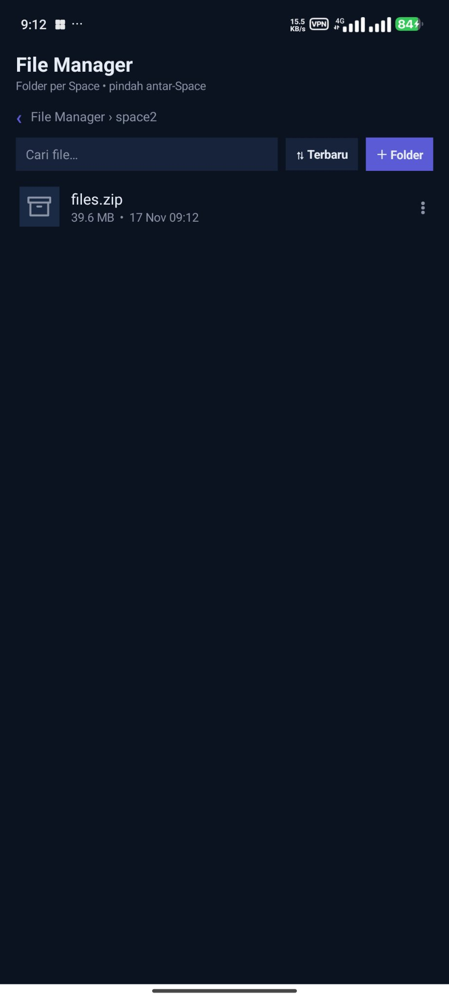
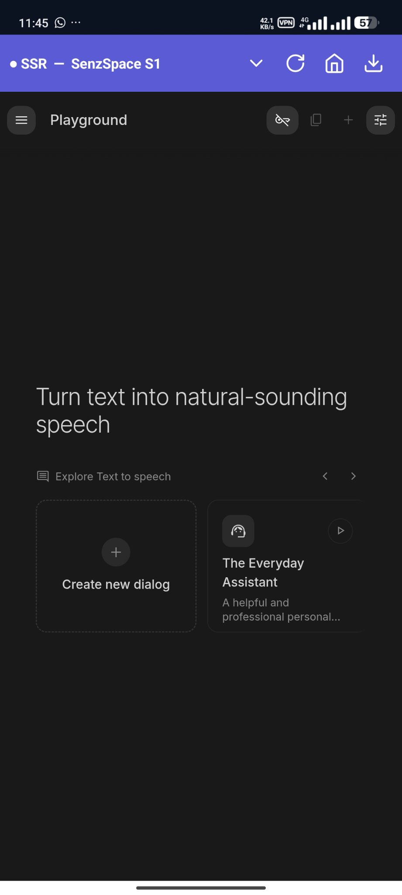
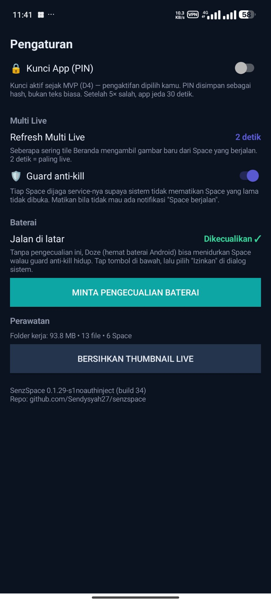

# SenzSpace

**Satu app Android untuk banyak akun sekaligus.** Tiap akun punya Space sendiri — semua jalan bareng, tanpa login-logout.

> Contoh: 6 akun Claude + 1 Google AI Studio untuk produksi konten — masing-masing hidup di Space-nya sendiri, lengkap dengan unduhan dan file manager.

## Unduh

### [⬇ Unduh SenzSpace versi terbaru (APK)](https://raw.githubusercontent.com/Sendysyah27/senzspace/main/releases/SenzSpace-latest.apk)

Link ini **selalu** mengarah ke versi terbaru — tidak perlu cari-cari rilis. Android 7 ke atas.

Install langsung dari HP (izinkan "install dari sumber tidak dikenal" sekali saat diminta). Update berikutnya: **install menimpa, jangan uninstall** — uninstall menghapus semua sesi login di semua Space.

Versi tertentu: [v0.1.47](https://raw.githubusercontent.com/Sendysyah27/senzspace/main/releases/SenzSpace-v0.1.47.apk) · [v0.1.46](https://raw.githubusercontent.com/Sendysyah27/senzspace/main/releases/SenzSpace-v0.1.46.apk) · [v0.1.45](https://raw.githubusercontent.com/Sendysyah27/senzspace/main/releases/SenzSpace-v0.1.45.apk) · [v0.1.44](https://raw.githubusercontent.com/Sendysyah27/senzspace/main/releases/SenzSpace-v0.1.44.apk) · [v0.1.43](https://raw.githubusercontent.com/Sendysyah27/senzspace/main/releases/SenzSpace-v0.1.43.apk) · [v0.1.42](https://raw.githubusercontent.com/Sendysyah27/senzspace/main/releases/SenzSpace-v0.1.42.apk) · [v0.1.41](https://raw.githubusercontent.com/Sendysyah27/senzspace/main/releases/SenzSpace-v0.1.41.apk) · [semua rilis](https://github.com/Sendysyah27/senzspace/releases)

## Tampilan

| Beranda Multi Live | File Manager | AI Studio |
|---|---|---|
| Semua Space yang jalan terlihat sekaligus, lengkap dengan chip status (Aktif / Limit / Belum login). | Folder per Space, pindah antar-Space, Inbox Bersama, arsip episode. | Login Google sekali, Playground langsung kebuka — TTS, teks, dan unduhan audio di dalam app. |

  
  
  

## Kenapa SenzSpace?

Pindah akun hari ini = logout, login lagi, verifikasi, konteks hilang. SenzSpace memberi tiap akun satu **Space** (= Profile): cookie, login, riwayat, dan folder unduhan sendiri — seperti browser terpisah, tapi dalam 1 app.

## Fitur

- **Space per akun** — buat / hapus / ubah nama sendiri, **maksimal 10 Space**. Preset awal 7: Claude 1–6 + AI Studio. Bisa juga untuk situs apa pun (URL sendiri).
- **Multi Live di Beranda** — semua Space yang sedang jalan terlihat sekaligus (thumbnail live tiap 2 detik), lengkap dengan chip status: Aktif, Limit (dengan jam reset), atau Belum login.
- **Unduhan per Space** — file dari Claude / AI Studio langsung masuk folder Space-nya, nama asli + ekstensi benar (MP4, ZIP, SRT, WAV, PNG, …).
- **File Manager terpadu** — pindah file antar-Space, Inbox Bersama, arsip episode; lihat gambar / teks / video di dalam app; bagikan atau ekspor ke folder Download.
- **Split-screen + geser top bar** — buka 2 Space berdampingan; geser top bar buat pindah antar Space yang aktif.
- **Kunci App** — PIN 4 digit / biometrik (mati secara default, aktifkan di Pengaturan).
- **Beku Live** — matikan thumbnail live per Space (tahan lama kartu) tanpa mematikan Space-nya.
- **Bersihkan data Space** — hapus cookie + storage + cache satu Space (tahan lama kartu), obat kalau login di Space itu error terus.

## Cara pakai

1. Install APK di atas.
2. Buka app → tap kartu Space (mis. Claude 1).
3. Login seperti di browser biasa.
4. Ulangi untuk Space lain — semua jalan bareng, tidak saling mengeluarkan.
5. File unduhan masuk folder Space; pindah antar-Space lewat File Manager.

## Batas jujur

SenzSpace mengelola sesi login yang sah milik pengguna sendiri. App ini **tidak** melewati limit penggunaan, CAPTCHA, verifikasi, atau kebijakan layanan Claude / Google. Kalau platform memaksa login ulang, app menampilkan statusnya dengan jelas. Tidak ada otomasi klik / bot yang mengoperasikan akun tanpa pengguna, dan tidak ada pengakalan limit.

## Untuk pengembang

- Inti aturan Space (maks 10, preset 7) ada di Rust core (`rust/profile-core/`); shell Android ditulis Kotlin (WebView terisolasi per Space).
- Build resmi lewat GitHub Actions (`.github/workflows/android.yml`); status & riwayat build ada di tab Actions.
- Panduan tes per slice (bahasa bayi), arsitektur, dan build lokal: [`docs/PANDUAN-PENGEMBANG.md`](docs/PANDUAN-PENGEMBANG.md).
- Keputusan desain awal: [`docs/ADR-01.md`](docs/ADR-01.md).
- Kontribusi: [`CONTRIBUTING.md`](CONTRIBUTING.md).

## Lisensi

MIT — lihat [`LICENSE`](LICENSE).
